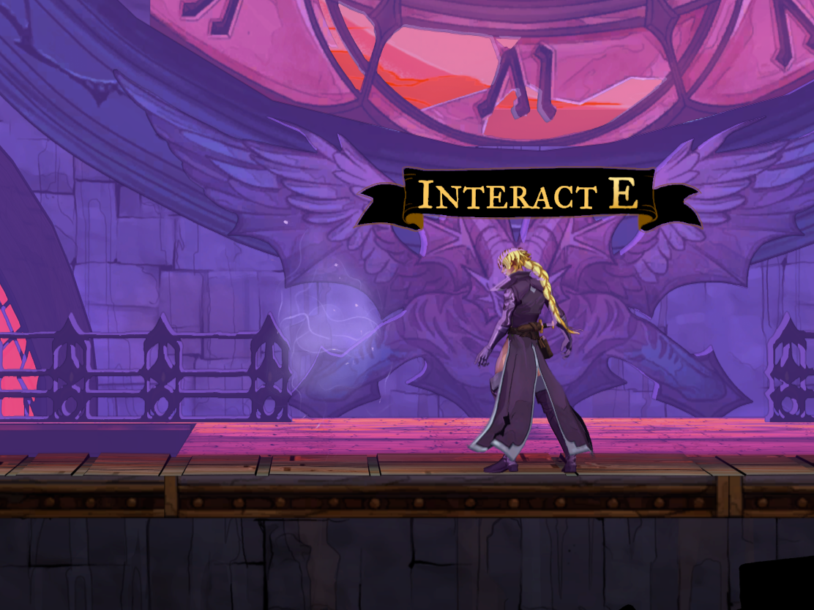
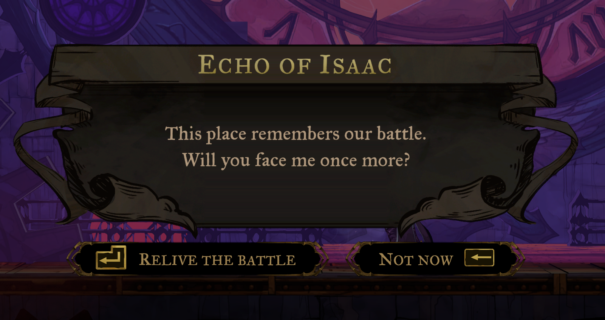
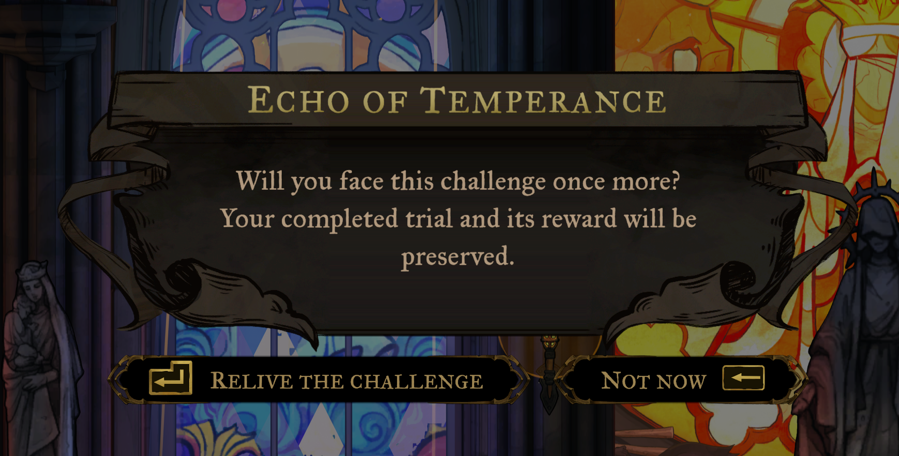
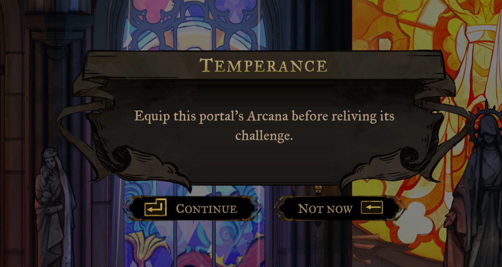
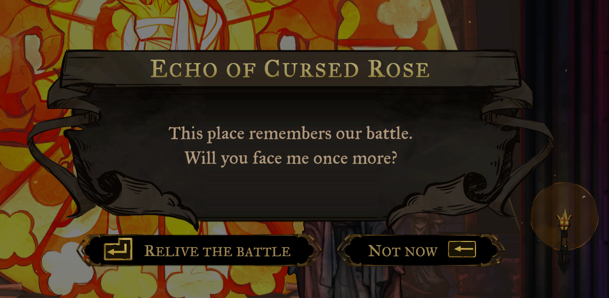
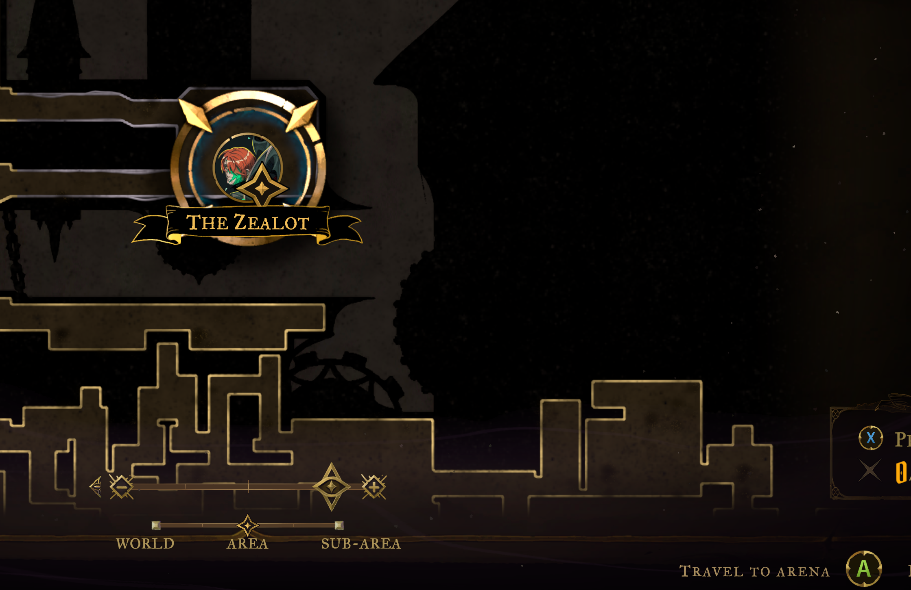
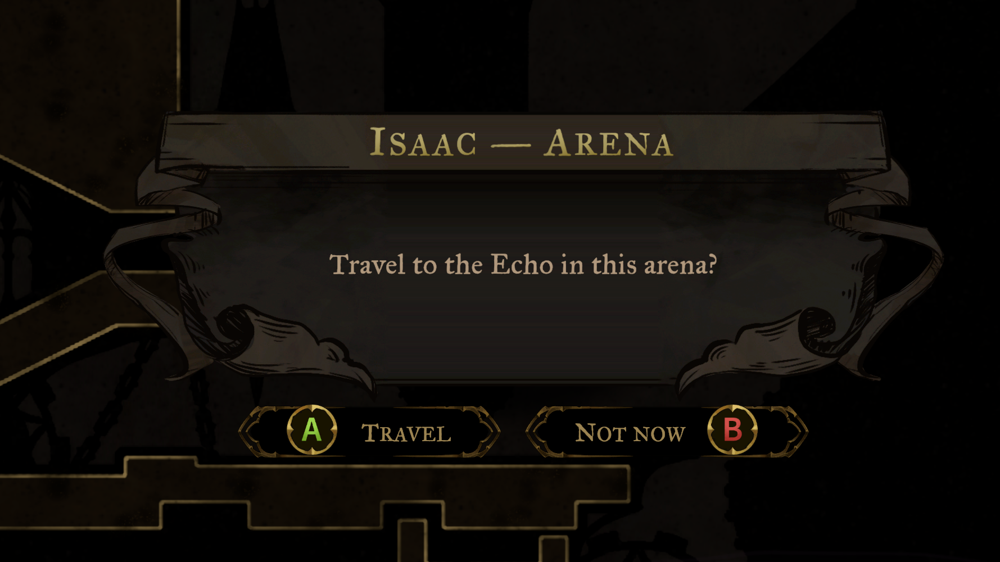

# Boss Rematch

Fight defeated bosses again in Castlevania: Belmont’s Curse. Return to an arena and speak to its spectral **Echo**, then choose **Relive the battle**. Uses the game’s normal interaction, confirmation and controller bindings.



## Install

Requires **BepInEx 6.0.788 for Unity IL2CPP, Windows x64**.

Download the plugin ZIP from [Releases](https://github.com/ollieatkinson/castlevania-belmonts-curse-boss-rematch/releases/latest).

Close the game and extract the **whole ZIP into the main game folder**, beside `Castlevania Belmont's Curse.exe`. The plugin belongs at `BepInEx/plugins/BossRematch.dll`.

On Linux/Proton, add `WINEDLLOVERRIDES="winhttp=n,b" %command%` to the game’s Steam launch options. Keep any other launch options you need.

To uninstall, close the game and delete `BepInEx/plugins/BossRematch.dll`.

## Rematches

You must have defeated the boss and absorbed its Arcana. Speak to the Echo in its cleared arena and confirm **Relive the battle**. You keep your current equipment and abilities. The Echo disappears during the intro and fight, then returns when you return to the cleared arena.



Supports **Jeanne d’Arc, Leon, Medusa, Mammon, Cursed Rose (Doppelganger), Arthur, Carmilla, Talos, Isaac and Agnes**. Death, Dracula and Saint Louis’s original encounter are not included.

### Notre-Dame challenges

Replay **Justice, Temperance, Prudence and Strength**, including the platforming courses and Joan of Arc’s trial rematch. Spirits appear beside the portals in the challenge hall after you have completed their trials. Equip the portal’s required Arcana, speak to its spirit and choose **Relive the challenge**. Cursed Rose has a spirit beside the central portal after you have defeated her.





The hall has **one shared travel destination** for all five encounters. Select its portrait on the Notre-Dame map and choose **Travel to challenge hall**. You arrive outside the courses. Spirits stand to the side of the portals and disappear during a replay. Completing a trial, or taking its exit, returns you to your checkpoint in the hall; completed virtues and rewards are preserved.



## Arena travel

Bosses whose Arcana you have absorbed become travel destinations in visited arenas. Select their portrait on the area map, use the normal interact button when **Travel to arena** appears, then confirm. You arrive beside the Echo; speak to it to begin the rematch.





Settings are in `BepInEx/config/ollieatkinson.bossrematch.cfg`:

```ini
[Map]
ShowBossIcons = true
FastTravelToArenas = true
```

Set either option to `false` to disable it, then restart the game. Mirror Fast Travel handles mirrors, landmarks and ferryman destinations separately.

## Progress and compatibility

The mod saves a checkpoint before a rematch. Repeat boss rewards and story progression are suppressed, and saving is paused during the fight. Winning reloads that checkpoint at your arena position, restoring health, resources and temporary pickups. Dying ends the replay and uses normal checkpoint respawning; the native boss-retry prompt is suppressed. Another level transition also ends the replay and uses the game’s normal destination.

Leon’s full rematch, Isaac’s spawn and fight start, and Arthur’s fight start have been checked in game. Medusa and Cursed Rose have also been checked through victory and checkpoint return with the 0.4.4 fixes. Notre-Dame hall travel, spirit prompts and Temperance’s course entry and return have been checked alongside Ultrawide, Map Secrets and Mirror Fast Travel. Other encounters and death respawning still need playtesting. Back up your save before using the mod.

Last verified on Steam build **25975867 / game version 1.1.3**. A different game version or DLL hash logs a warning and attempts to load. If required hooks cannot be installed, the mod disables itself. An unsupported encounter graph disables that replay and restores the checkpoint if one has already started. These checks cannot detect every possible game change. If something fails, include `BepInEx/LogOutput.log` when reporting it.

## Build

Requires the .NET 8 SDK and a game installation that has run BepInEx once.

```sh
GamePath="/path/to/Castlevania Belmont's Curse" bash scripts/package.sh
```

The plugin ZIP and SHA-256 checksum are written to `dist/`. BepInEx and game assemblies are references only and are not included.

MIT. Unofficial community mod. Screenshots show game artwork belonging to its respective owners.
